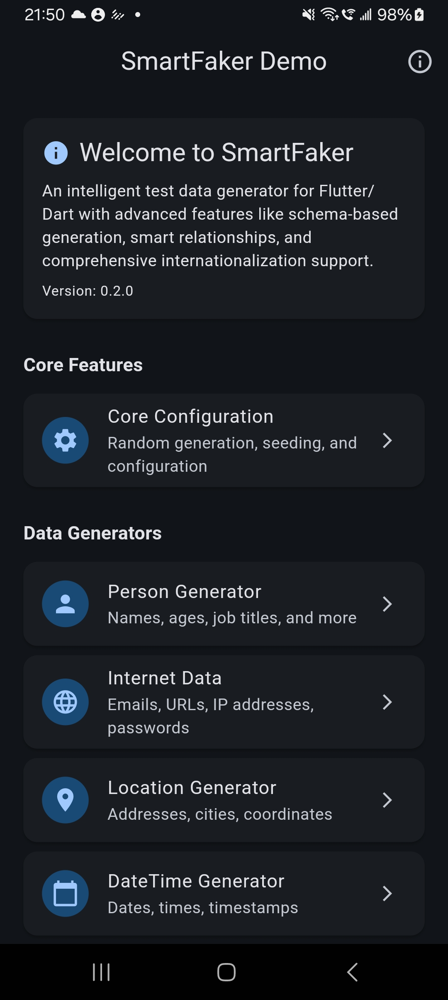
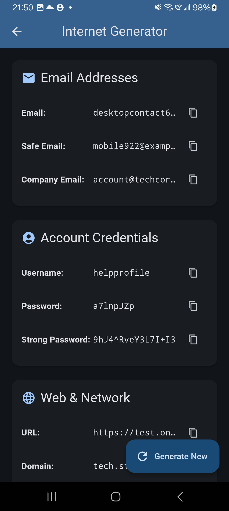
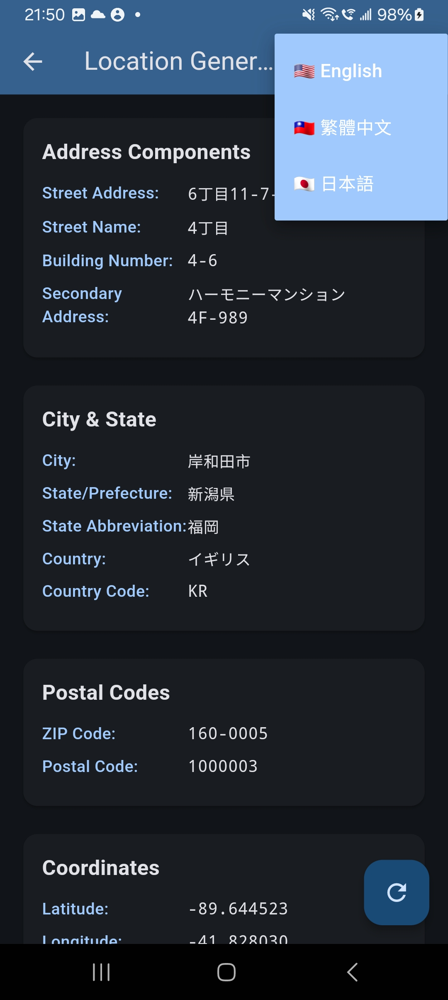
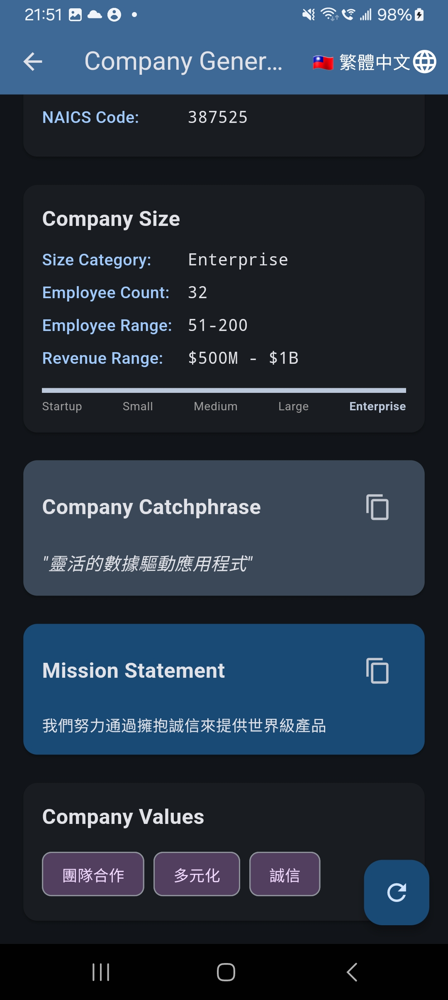
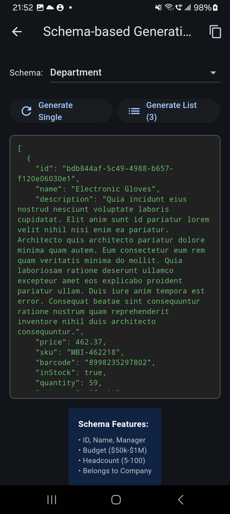
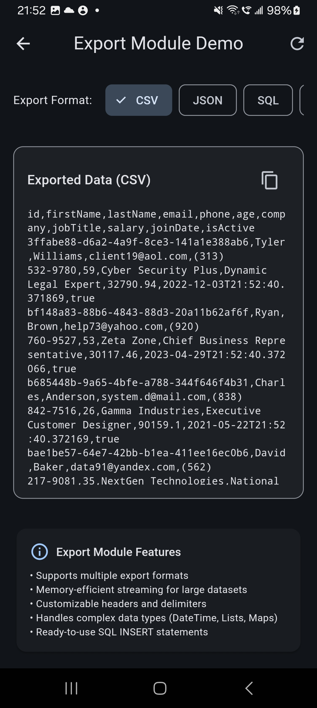

# SmartFaker

[](https://pub.dev/packages/smart_faker)
[](https://opensource.org/licenses/MIT)

FlutterとDartアプリケーション向けの強力でインテリジェントなフェイクデータジェネレーター。SmartFakerは、スマートリレーションシップ、国際化サポート、スキーマベースの生成を含む包括的なテストデータ生成を提供します。

## スクリーンショット

<p align="center">
  
  
  
  
</p>
<p align="center">
  
  
  
</p>

**バージョン：** 0.5.1
**最終更新：** 2025-09-24

## 📦 リソース

- **GitHubリポジトリ：** [https://github.com/tienenwu/smart_faker](https://github.com/tienenwu/smart_faker)
- **デモアプリケーション：** リポジトリの `/demo` フォルダにすべての機能の包括的なサンプルがあります
- **APIドキュメント：** [pub.dev/documentation/smart_faker](https://pub.dev/documentation/smart_faker/latest/)
- **CLI クイックスタート：** `dart run bin/smart_faker_cli.dart --help`

## 機能

- 🌍 **多言語サポート**：英語、繁体字中国語、日本語
- 🔗 **スマートリレーションシップ**：一貫した関係を持つリアルなデータを作成
- 📊 **スキーマベース生成**：データ構造を定義し、一貫したフェイクデータを生成
- 🎯 **タイプセーフAPI**：完全に型付けされたインターフェースで、より良いIDEサポートと実行時エラーの削減
- 🔄 **再現可能な結果**：シードベースの生成で一貫したテストデータ
- 🏗️ **ファクトリーパターン**：データクラスと統合する複数の方法
- ⚡ **高パフォーマンス**：大規模なデータセット用に最適化
- 🎨 **豊富なデータタイプ**：人物、インターネット、場所、商業、金融など20以上のモジュール
- 📤 **データエクスポート**：CSV、JSON、SQL、XML、YAML、Markdown形式へのエクスポート（v0.2.0新機能！）
- 🇹🇼 **台湾モジュール**：身分証番号、統一番号などを含む台湾固有のデータ生成（v0.2.0新機能！）
- 🎯 **パターンモジュール**：正規表現から検証ルールに適合するフェイクデータを生成（v0.3.0新機能！）
- 🚀 **モックサーバースイート**：REST・GraphQL・SSE/WebSocket・録画/リプレイに対応（v0.5.1新機能！）
- 🧰 **スキーマインポートとCLI**：JSON Schema / OpenAPI / Prisma を取り込み、新しいCLIでデータ生成（v0.5.1新機能！）
- 🔐 **プライバシーツールキット**：マスキング、匿名化、合成データ生成をサポート（v0.5.1新機能！）

## インストール

`pubspec.yaml`に`smart_faker`を追加：

```yaml
dependencies:
  smart_faker: ^0.5.1
```

次に実行：

```bash
flutter pub get
```

## クイックスタート

### 基本的な使用法

```dart
import 'package:smart_faker/smart_faker.dart';

void main() {
  final faker = SmartFaker();
  
  // 基本データの生成
  print(faker.person.fullName());        // "John Smith"
  print(faker.internet.email());         // "john.smith@example.com"
  print(faker.location.city());          // "New York"
  print(faker.commerce.productName());   // "エルゴノミックラバーキーボード"
}
```

### 異なるロケールの使用

```dart
// 繁体字中国語ロケール
final zhFaker = SmartFaker(locale: 'zh_TW');
print(zhFaker.person.fullName());      // "王小明"
print(zhFaker.location.city());        // "台北市"
print(zhFaker.company.name());         // "科技有限公司"

// 日本語ロケール
final jaFaker = SmartFaker(locale: 'ja_JP');
print(jaFaker.person.fullName());      // "山田太郎"
print(jaFaker.company.name());         // "株式会社山田"
print(jaFaker.location.city());        // "東京都"
```

### シードによる再現可能なデータ

```dart
// 同じシードは同じデータを生成
final faker1 = SmartFaker(seed: 42);
final faker2 = SmartFaker(seed: 42);

print(faker1.person.fullName() == faker2.person.fullName()); // true
```

## データクラスの統合

### 方法1：ファクトリーコンストラクタ

```dart
class User {
  final String id;
  final String name;
  final String email;
  final int age;
  
  const User({
    required this.id,
    required this.name,
    required this.email,
    required this.age,
  });
  
  // フェイクデータ用のファクトリーコンストラクタを追加
  factory User.fake() {
    final faker = SmartFaker();
    return User(
      id: faker.random.uuid(),
      name: faker.person.fullName(),
      email: faker.internet.email(),
      age: faker.random.integer(min: 18, max: 65),
    );
  }
  
  // 複数のインスタンスを生成
  static List<User> fakeList(int count) {
    return List.generate(count, (_) => User.fake());
  }
}

// 使用方法
final user = User.fake();
final users = User.fakeList(10);
```

### 方法2：拡張メソッド

```dart
class Product {
  final String id;
  final String name;
  final double price;
  
  const Product({
    required this.id,
    required this.name,
    required this.price,
  });
}

// 拡張でフェイクデータ生成を追加
extension ProductFaker on Product {
  static Product fake() {
    final faker = SmartFaker();
    return Product(
      id: faker.random.uuid(),
      name: faker.commerce.productName(),
      price: faker.commerce.price(min: 9.99, max: 999.99),
    );
  }
}

// 使用方法
final product = ProductFaker.fake();
```

## スキーマベースの生成

リレーションシップを持つ複雑なデータ構造を定義：

```dart
final faker = SmartFaker();
final builder = SchemaBuilder(faker);

// ユーザースキーマを定義
final userSchema = SchemaBuilder.defineSchema('User')
  .id()
  .withName()
  .withContact()
  .field('age', FakerFieldType.integer, min: 18, max: 65)
  .withTimestamps()
  .build();

// リレーションシップを持つ注文スキーマを定義
final orderSchema = SchemaBuilder.defineSchema('Order')
  .id()
  .belongsTo('userId', 'User')
  .field('total', FakerFieldType.amount, min: 10, max: 1000)
  .field('status', FakerFieldType.word)
  .withTimestamps()
  .build();

// スキーマを登録
builder.registerSchema(userSchema);
builder.registerSchema(orderSchema);

// リレーションシップを持つデータを生成
final order = builder.generate('Order');
print(order); // 有効なuserIdリファレンスを持つ注文
```

## スマートリレーションシップ

一貫した関係を持つリアルな関連データを作成：

```dart
final faker = SmartFaker();
final manager = RelationshipManager(faker);
final relationshipBuilder = SmartRelationshipBuilder(
  manager: manager,
  faker: faker,
);

// 1対多：ユーザーと投稿
final user = relationshipBuilder.oneToMany(
  parentSchema: 'User',
  childSchema: 'Post',
  parent: {
    'name': faker.person.fullName(),
    'email': faker.internet.email(),
  },
  childrenGenerator: (userId) => List.generate(3, (_) => {
    'title': faker.lorem.sentence(),
    'content': faker.lorem.paragraph(),
    'authorId': userId,
  }),
);

// 多対多：ユーザーとロール
final pivotData = relationshipBuilder.manyToMany(
  schema1: 'User',
  schema2: 'Role',
  pivotSchema: 'UserRole',
  items1: users,
  items2: roles,
);

// 階層構造：組織図
final orgChart = relationshipBuilder.hierarchy(
  schema: 'Department',
  nodeGenerator: (depth, parentId) => {
    'name': faker.commerce.department(),
    'budget': faker.finance.amount(min: 50000, max: 500000),
  },
  maxDepth: 3,
  childrenPerNode: 4,
);
```

## 利用可能なモジュール

### 人物モジュール
```dart
faker.person.firstName()      // "太郎"
faker.person.lastName()       // "山田"
faker.person.fullName()       // "山田太郎"
faker.person.prefix()         // "Mr."
faker.person.suffix()         // "Jr."
faker.person.gender()         // "男性"
faker.person.jobTitle()       // "シニア開発者"
```

### インターネットモジュール
```dart
faker.internet.email()        // "user@example.com"
faker.internet.username()     // "cooluser123"
faker.internet.password()     // "SecurePass123!"
faker.internet.url()          // "https://example.com"
faker.internet.ipv4()         // "192.168.1.1"
faker.internet.ipv6()         // "2001:0db8:85a3::8a2e:0370:7334"
faker.internet.macAddress()   // "00:1B:44:11:3A:B7"
faker.internet.userAgent()    // "Mozilla/5.0..."
faker.internet.domainName()   // "example.com"
```

### 場所モジュール
```dart
faker.location.country()      // "日本"
faker.location.city()          // "東京"
faker.location.state()         // "東京都"
faker.location.zipCode()       // "100-0001"
faker.location.streetAddress() // "中央区1-2-3"
faker.location.latitude()      // 35.6762
faker.location.longitude()     // 139.6503
faker.location.coordinates()   // Coordinatesオブジェクト
faker.location.timeZone()      // "Asia/Tokyo"
```

### パターンモジュール（Pattern Module）- v0.3.0新機能！
```dart
// 正規表現からデータを生成
faker.pattern.fromRegex(r'^\d{5}$')         // "12345"
faker.pattern.fromRegex(r'^[A-Z]{3}-\d{4}$') // "ABC-1234"
faker.pattern.fromRegex(r'^09\d{8}$')       // "0912345678"

// プリセットパターンで一般的なフォーマットを生成
faker.pattern.taiwanPhone()      // "0912-345-678"
faker.pattern.taiwanIdFormat()   // "A123456789"
faker.pattern.usPhone()          // "(555) 123-4567"
faker.pattern.japanPhone()       // "090-1234-5678"
faker.pattern.emailFormat()      // "john.doe@example.com"
faker.pattern.visaFormat()       // "4532 1234 5678 9012"
faker.pattern.mastercardFormat() // "5412 3456 7890 1234"
faker.pattern.orderIdFormat()    // "ORD-1234567890"
faker.pattern.skuFormat()        // "SKU-123456"
faker.pattern.ipv4Format()       // "192.168.1.1"
faker.pattern.macAddressFormat() // "00:1B:44:11:3A:B7"
faker.pattern.hexColorFormat()   // "#FF5733"
faker.pattern.uuidFormat()       // "550e8400-e29b-41d4-a716-446655440000"

// カスタム注文番号プレフィックス
faker.pattern.orderIdFormat(prefix: 'INV') // "INV-1234567890"

// カスタム請求書年度
faker.pattern.invoiceFormat(year: 2025)    // "INV-20251234567"
```

### その他のモジュール

- **商業（Commerce）**：製品、価格、カテゴリー、SKU
- **会社（Company）**：会社名、キャッチフレーズ、業界
- **金融（Finance）**：金額、クレジットカード、IBAN、暗号通貨
- **日時（DateTime）**：過去、未来、最近、間
- **Lorem**：単語、文章、段落
- **画像（Image）**：アバター、画像URL、SVG
- **電話（Phone）**：電話番号、国コード、市外局番
- **車両（Vehicle）**：VIN、ナンバープレート、メーカー、モデル
- **システム（System）**：ファイルパス、MIMEタイプ、拡張子
- **色（Color）**：16進数カラー、RGB、HSL
- **暗号通貨（Crypto）**：ビットコイン/イーサリアムアドレス、ハッシュ
- **食品（Food）**：料理、材料、レストラン、料理ジャンル
- **音楽（Music）**：ジャンル、アーティスト、曲、アルバム
- **プライバシー（Privacy）**：フィールドマスキング、PII検出、合成データ

## 高度な使用法

### バッチ生成

```dart
// 効率的に複数のアイテムを生成
final faker = SmartFaker(seed: 42);

// 一貫した関係を持つ100人のユーザーを生成
final users = List.generate(100, (_) => User.fake());

// 関連データを生成
final posts = <Map<String, dynamic>>[];
for (final user in users) {
  final userPosts = List.generate(
    faker.random.integer(min: 1, max: 5),
    (_) => {
      'userId': user.id,
      'title': faker.lorem.sentence(),
      'content': faker.lorem.paragraphs(3),
      'publishedAt': faker.dateTime.recent().toIso8601String(),
    },
  );
  posts.addAll(userPosts);
}
```

### カスタムアバター生成

```dart
// カスタムオプションでローカルアバターを生成
final avatar = faker.image.localAvatar(
  name: faker.person.fullName(),
  size: AvatarSize.large,    // 128x128
  shape: AvatarShape.circle,
  backgroundColor: '#3498db',
);

// Flutter widgetで使用
Container(
  width: 128,
  height: 128,
  decoration: BoxDecoration(
    shape: BoxShape.circle,
    image: DecorationImage(
      image: MemoryImage(base64Decode(avatar.split(',')[1])),
    ),
  ),
)
```

## 一般的な使用例

### 1. Eコマースアプリケーションのテスト
```dart
// テスト製品を生成
final products = List.generate(50, (_) => {
  'id': faker.random.uuid(),
  'name': faker.commerce.productName(),
  'price': faker.commerce.price(min: 10, max: 1000),
  'category': faker.commerce.category(),
  'inStock': faker.random.boolean(),
  'rating': faker.random.integer(min: 1, max: 5),
});
```

### 2. APIレスポンスのモック
```dart
Map<String, dynamic> mockUserResponse() {
  final faker = SmartFaker();
  return {
    'status': 'success',
    'data': {
      'user': {
        'id': faker.random.uuid(),
        'profile': {
          'firstName': faker.person.firstName(),
          'lastName': faker.person.lastName(),
          'avatar': faker.image.avatar(),
          'email': faker.internet.email(),
        },
      }
    }
  };
}
```

### 3. データベースシーディング
```dart
Future<void> seedDatabase() async {
  final faker = SmartFaker(seed: 12345); // 再現可能なデータ
  
  // ユーザーを作成
  for (int i = 0; i < 100; i++) {
    await db.insert('users', {
      'name': faker.person.fullName(),
      'email': faker.internet.email(),
      'created_at': faker.dateTime.past(),
    });
  }
}
```

## APIモックとストリーミング - v0.5.1新機能！

SmartFaker 0.5.1 ではモックサーバーが REST / GraphQL / SSE / WebSocket に対応し、録画・リプレイや CLI からの操作も可能になりました。詳しい英語ドキュメントは本家 README を参照してください。以下は代表的なコード例です。

```dart
final faker = SmartFaker();
final mockServer = faker.createMockApi();

mockServer.get('/api/users', (request) {
  return List.generate(3, (_) => {
        'id': faker.datatype.uuid(),
        'name': faker.person.fullName(),
        'email': faker.internet.email(),
      });
});

final graphQL = mockServer.graphQL('/graphql');

graphQL.query('viewer', (context) {
  return {
    'id': context.faker.datatype.uuid(),
    'name': context.faker.person.fullName(),
  };
});
```

CLI からは次のように利用できます。

```bash
dart run bin/smart_faker_cli.dart mock --port 3000 --record demo
dart run bin/smart_faker_cli.dart generate --schema-file api/schema.json --schema Order --count 10
```


## トラブルシューティング

### よくある問題

1. **DateTimeシリアライズエラー**
   - JSONで使用する際は必ずDateTimeを文字列に変換
   ```dart
   'createdAt': faker.dateTime.past().toIso8601String()
   ```

2. **ロケールが機能しない**
   - サポートされているロケールを確認：`en_US`、`zh_TW`、または`ja_JP`
   - スペルと大文字小文字を確認

3. **再現可能なデータが機能しない**
   - 同じシード値を使用
   - シードで新しいSmartFakerインスタンスを作成

## パフォーマンスのヒント

1. **Fakerインスタンスの再利用**：一度作成して再利用することでパフォーマンスが向上
2. **バッチ生成の使用**：単一ループで複数のアイテムを生成
3. **遅延読み込み**：必要な時だけデータを生成
4. **テスト用シード**：再現可能な結果のためにテストでシードを使用

## サポートされているロケール

- `en_US` - 英語（米国）- デフォルト
- `zh_TW` - 繁体字中国語
- `ja_JP` - 日本語

## サンプルアプリケーション

[GitHubリポジトリ](https://github.com/tienenwu/smart_faker/tree/main/demo)に包括的なデモアプリケーションがあります。デモには以下が含まれます：

- すべてのデータ生成モジュール
- ライブサンプル付きのスキーマベース生成
- スマートリレーションシップのデモンストレーション
- 多言語サポート
- カスタムアバター生成
- 異なるユースケースを示すインタラクティブフォーム

デモを実行：

```bash
git clone https://github.com/tienenwu/smart_faker.git
cd smart_faker/demo
flutter run
```

## コントリビューション

コントリビューションを歓迎します！お気軽にPull Requestを提出してください。

1. リポジトリをFork
2. 機能ブランチを作成（`git checkout -b feature/AmazingFeature`）
3. 変更をコミット（`git commit -m 'Add some AmazingFeature'`）
4. ブランチにプッシュ（`git push origin feature/AmazingFeature`）
5. Pull Requestを開く

## ライセンス

このプロジェクトはMITライセンスの下でライセンスされています - 詳細は[LICENSE](LICENSE)ファイルを参照してください。

## 謝辞

- [Faker.js](https://github.com/faker-js/faker)と[Bogus](https://github.com/bchavez/Bogus)にインスパイアされました
- Flutterコミュニティのために❤️で構築

## サポート

このパッケージが役立つと思われる場合、開発をサポートできます：

[](https://buymeacoffee.com/wutienenc)

また、以下もご検討ください：
- ⭐ リポジトリにスターを付ける
- 🐛 バグを報告する
- 💡 新機能を提案する
- 📖 ドキュメントを改善する

バグや機能リクエストについては、[issueを作成](https://github.com/tienenwu/smart_faker/issues)してください。
